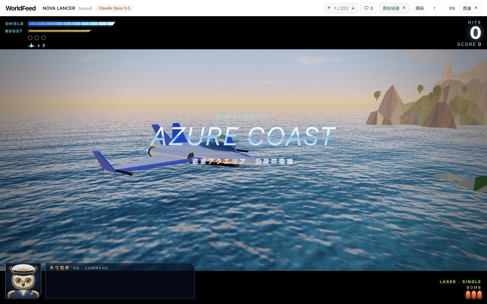
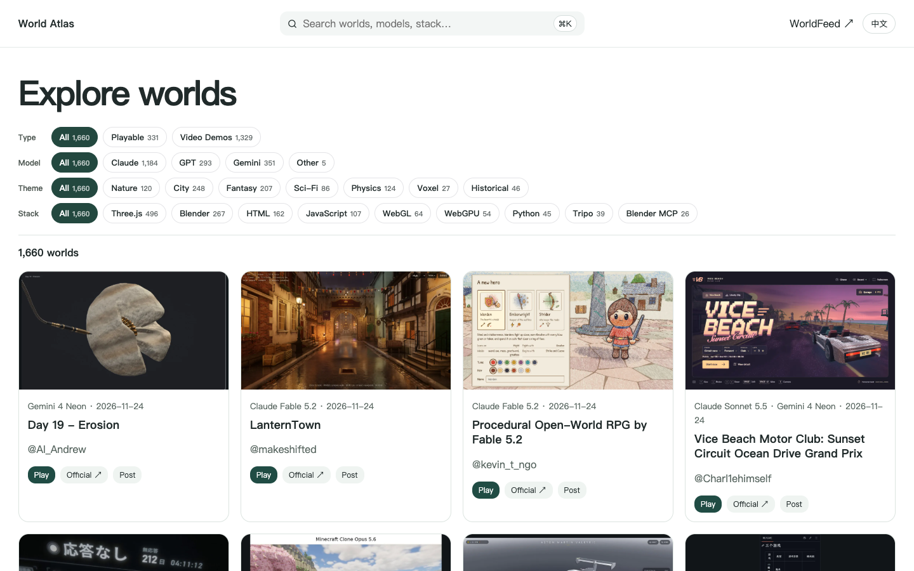

# WorldFeed

**English** | [简体中文](README.zh-CN.md)

Swipe through **hundreds of playable AI-generated 3D worlds** full-screen in your browser — backed by a daily-updated open catalog tracking the entire frontier AI 3D scene (**1,672** worlds and growing).

**[▶ Launch WorldFeed (Live 3D Feed)](https://worldfeed.space/)** · **[WorldFeed Explore (Full Catalog)](https://explore.worldfeed.space/)** · **[Trends Report](reports/frontier_trends_report.md)** · **[Public Dataset (JSON)](data/exports/ai_worlds.json)**



---

## Two Ways to Browse, One Pipeline

| Mode | What it does | Live Snapshot |
|---|---|---|
| **[WorldFeed](https://worldfeed.space/)** (`feed/`) | Full-screen, zero-overlay live 3D feed. Every swipe mounts a real interactive browser world immediately. Use `↑`/`↓` or top-bar scroll to switch, `L` to like, `G` for the creator's original site, and `O` for the source post. | **223** directly playable worlds (2 licensed same-origin mirrors + 221 live embeds) |
| **[WorldFeed Explore](https://explore.worldfeed.space/)** (`platform/`) | Fast, full-width static gallery with instant search and filters by Playable / Video Demos, Model (`Claude`, `GPT`, `Gemini`, `Other`), Theme, and Tech Stack. Playable entries jump straight into WorldFeed while preserving original creator links. | **1,672** frontier worlds (**331** live demos · **1,341** video/coded-3D showcases · 98.4% with cover art) |



---

## Scope & Data Quality

- **Frontier Models Only (Frontend)**: Tracks interactive 3D worlds and AI-coded 3D scenes built with frontier releases (`Claude Fable 5.2+`, `Claude Opus 5.5/5.6+`, `GPT-6.2 Astra/Sol+`, `Gemini 4 Neon/Carbon/Hydrogen/Argon+`). Legacy archive entries (559 worlds) remain preserved in `data/processed/cases.jsonl` and `data/exports/ai_worlds.json`.
- **Clean Filtering**: Excludes 2D-only games, repo/tool listicles, sponsored/PR promos, diffusion-only video clips, and secondary aggregator reposts.
- **Verified Recall & Precision**: Evaluated against two held-out blind benchmarks with zero seed leakage:
  - [V1 Holdout](reports/golden_eval_v1.md): **90.9%** core recall (`10/11`), **0%** negative leakage, **0%** aggregator misattribution.
  - [V2 Independent External Holdout](reports/golden_eval_v2.md): **88.9%** core recall (`8/9`), **0%** negative leakage.
- **Automated Daily Sync**: Runs incrementally via [`.github/workflows/sync-worlds.yml`](.github/workflows/sync-worlds.yml) to discover new X posts, verify creator attribution, refresh GitHub stars & embed probes, regenerate [`reports/frontier_trends_report.md`](reports/frontier_trends_report.md), and publish static snapshots.

---

## Repository Layout

```text
feed/        # WorldFeed (Vite + React) — full-screen playable 3D feed
platform/    # WorldFeed Explore (Next.js / vinext static export) — searchable gallery
src/         # Python discovery, attribution, dedup, verification & publishing pipeline
config/      # Seeds, curated catalogs, and held-out V1/V2 blind benchmarks
data/        # Public exports (ai_worlds.json, meta.json) & durable review ledger
reports/     # Trends report, acceptance reports, and blind-eval diagnostics
```

---

## Quick Local Run

Requires **Node.js 22+** and **Python 3.11+**.

```bash
# 1. Run WorldFeed locally
cd feed && npm ci && npm run build && npm run preview

# 2. Build & preview WorldFeed Explore locally
cd platform && npm ci && npm run build:static && python3 -m http.server 8000 --directory out

# 3. Run Python unit tests (offline, no API keys required)
uv sync --python 3.11
X_ADAPTER=mock uv run pytest -q
```

---

## Data & Attribution

Every listed world links back to its original creator's post, live demo, and/or public repository. Mirrored worlds in `feed/public/mirrors/` include their original open-source licenses and attribution.
