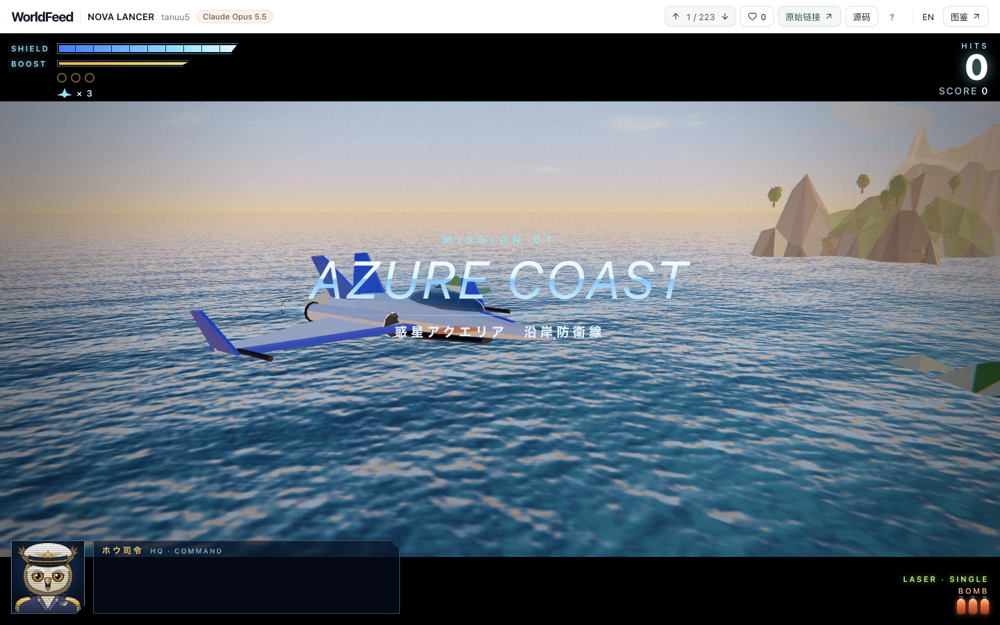
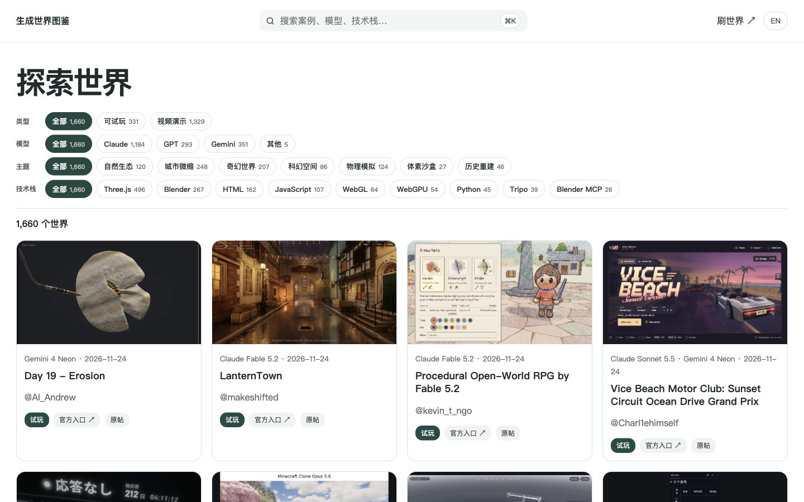

# WorldFeed

[English](README.md) | **简体中文**

像刷短视频一样全屏连玩**全网数百个 AI 创作的实时 3D 世界**——背后由每日自动更新的前沿 AI 3D 世界开源目录驱动（已收录 **1,672** 个且持续增长）。

**[▶ 打开 WorldFeed（全屏试玩流）](https://worldfeed.space/)** · **[WorldFeed 探索（全网目录）](https://explore.worldfeed.space/)** · **[前沿趋势报告](reports/frontier_trends_report.md)** · **[公开数据（JSON）](data/exports/ai_worlds.json)**



---

## 两种逛法，一套管线

| 模式 | 定位与体验 | 当前收录 |
|---|---|---|
| **[WorldFeed](https://worldfeed.space/)**（`feed/`） | 极简零遮挡全屏 3D 试玩流。每次切换直接挂载可交互的实时 3D 画布，支持 `↑`/`↓` 或顶栏滚轮切世界、`L` 点赞、`G` 直达作者原站、`O` 查看原帖。 | **223** 个可站内直玩世界（2 个开源同源镜像 + 221 个实时嵌入） |
| **[WorldFeed 探索](https://explore.worldfeed.space/)**（`platform/`） | 全横屏纯静态画廊目录，支持全文检索以及按「可试玩 / 视频演示」、模型（`Claude` / `GPT` / `Gemini` / `其他`）、主题和技术栈筛选。可站内试玩的作品直达 WorldFeed，同时保留作者官方入口与原帖。 | **1,672** 个前沿世界（**331** 个在线试玩 · **1,341** 个视频/代码 3D 演示 · 98.4% 含封面） |



---

## 收录口径与质量控制

- **聚焦前沿模型**：前端仅展示前沿模型作品（`Claude Fable 5.2+`、`Claude Opus 5.5/5.6+`、`GPT-6.2 Astra/Sol+`、`Gemini 4 Neon/Carbon/Hydrogen/Argon+`）。559 条历史归档数据保留在 `data/processed/cases.jsonl` 与 `data/exports/ai_worlds.json` 中。
- **严格去噪**：自动排除纯 2D 游戏、工具/仓库清单、商单/PR 推广、纯扩散视频剪辑及二次搬运号署名。
- **双盲测独立验证**（留出集零泄露进种子）：
  - [V1 留出集](reports/golden_eval_v1.md)：核心召回 **90.9%**（`10/11`），负样本泄漏 **0%**，搬运号误署名 **0%**。
  - [V2 独立外部抽样集](reports/golden_eval_v2.md)：核心召回 **88.9%**（`8/9`），负样本泄漏 **0%**。
- **每日自动同步**：通过 [`.github/workflows/sync-worlds.yml`](.github/workflows/sync-worlds.yml) 增量抓取新帖、核查作者归属、刷新 GitHub Star 与嵌入探测、重生成 [`reports/frontier_trends_report.md`](reports/frontier_trends_report.md) 并更新静态产物。

---

## 目录结构

```text
feed/        # WorldFeed（Vite + React）—— 全屏实时 3D 试玩流
platform/    # WorldFeed 探索（Next.js / vinext 静态导出）—— 全横屏检索画廊
src/         # Python 采集、归属核验、去重、评测与发布管线
config/      # 种子配置、目录源与 V1/V2 盲测基准集
data/        # 公开导出快照（ai_worlds.json、meta.json）与审核台账
reports/     # 趋势分析报告、上线验收报告与盲测明细
```

---

## 本地运行

环境要求：**Node.js 22+**、**Python 3.11+**。

```bash
# 1. 本地预览 WorldFeed
cd feed && npm ci && npm run build && npm run preview

# 2. 本地构建并预览 WorldFeed 探索
cd platform && npm ci && npm run build:static && python3 -m http.server 8000 --directory out

# 3. 运行 Python 离线单测（无需密钥）
uv sync --python 3.11
X_ADAPTER=mock uv run pytest -q
```

---

## 版权与署名

每条作品均保留原作者帖子、官方试玩入口及公开源码仓库链接。`feed/public/mirrors/` 中的同源镜像均完整保留其原始开源许可证与署名信息。
